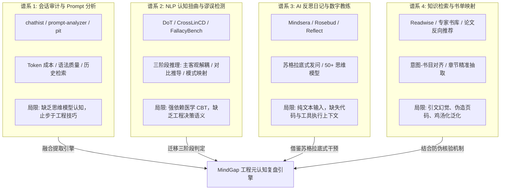

# 认知盲点与对话分析生态评测报告
> MindGap 深度调研体系 · 交付成果 Phase 1-A  
> 归属项目：`mindgap` | 状态：正式归档 | 版本：v1.0

---

## 摘要与评测背景

随着以终端 CLI 形式运行的自主 AI Agent（如 Claude Code、OpenAI Codex CLI、Google Antigravity CLI、Grok Build）深度融入现代软件研发，人类工程师的工作流已经从“手动编码”全面转向“人机协同决策”。在这一范式转变中，人类在终端中的提问、反馈、追问、质疑与妥协，成为了其底层**心智模型（Mental Model）在高认知负荷下的高频映射**。

然而，现存的工具生态要么停留在**浅层 Prompt 提示词优化与成本监控**，要么局限于**临床心理学层面的认知行为治疗（CBT）**，抑或是缺乏研发真实上下文的**泛哲学数字日记**。

本报告对业界和学术界的四大关联技术谱系以及底层开源基础设施进行系统化的横向扫描与深度评测，明确界定其技术迁移可行性、架构局限，并推导构建高信噪比工程元认知分析系统的生态基准。

---

## 一、四大关联技术谱系的横向评测

---

### 1.1 谱系一：会话审计与 Prompt 分析工具

#### 调研对象
- **`chathist` (shuntaka9576/chathist)**：面向 Claude Code 的极简终端会话历史查看器，利用 `fzf` 和 `fzf-tmux` 实时预览会话与项目。
- **`prompt-analyzer` (carbonbasednerd/prompt-analyzer)**：基于本地轻量 LLM（Ollama）的指令审计旁路，将指令沉淀到追加账本，提取语义主张并识别上下文矛盾。
- **`pit` (itisrmk/pit - Prompt Information Tracker)**：将 Git 版本控制思想引入 Prompt 演化追踪，记录 Prompt 的变更差异。
- **LLM Observability Trace Analyzers**：各开源社区与商业平台提供的 Token 开销、会话流耗时监控。

#### 核心机制与分析维度
1. **数据解析层面**：绝大多数开源会话工具依赖正则或流式 JSON 行切分，主要捕获输入长度、耗时、Token 消耗量、调用频次等表面统计指标。
2. **评估语义层面**：主要集中于“Prompt 质量评分”（如是否明确指示输出格式、是否提供 Few-shot、是否包含角色设定、是否有清晰约束）。

#### 优势与可借鉴点
- **零侵入捕获**：解析机制轻量，能在不污染主开发流程的情况下直接从本地历史文件（如 `history.jsonl`）中提取记录。
- **矛盾识别雏形**：`prompt-analyzer` 的局部断言检测证明了利用模型分析历史提示词前后自相矛盾的可行性。

#### 致命局限与技术代差
- **思维层面的虚无**：把“提示词是否遵循提示工程技巧（Prompt Engineering Tricks）”等同于“人类思维是否成熟”。若用户用非常标准规范的格式下达了一个架构上完全错误的指令（如“请帮我把一个 50 行的辅助脚本拆分为包含 12 个微服务并引入分布式事务管理器”），此类工具会判定为“高质量 Prompt”，而实质上暴露了严重的**复杂度偏见（Complexity Bias）**与**过度工程化盲区**。
- **缺乏反思深度**：无法识别用户的思考打转（Thrashing）、情绪化下达无效指令、以及不断打补丁的局部妥协。

---

### 1.2 谱系二：NLP 认知扭曲与逻辑谬误检测

#### 调研对象
- **Diagnosis of Thought (DoT)** (EMNLP 2023, Chen et al.)：临床心理学对话诊断框架，提出通过三阶段认知解耦提升大模型检测认知扭曲的能力。
- **CrossLinCD** (ACL 2024 Findings)：跨语种、跨数据集认知扭曲标准化基准体系，基于多任务微调解决临床标注不一致问题。
- **llm-cognitive-distortion-detection / FallacyBench / LogicBench**：学术界针对经典非形式逻辑谬误（如稻草人谬误、滑坡谬误、人身攻击、诉诸权威）的自动检测基准。

#### 核心机制评测：Diagnosis of Thought (DoT) 的三阶段架构
DoT 之所以能在认知扭曲检测上超越传统的黑盒直接判定（Vanilla Direct Classification），关键在于其认知解耦设计：
1. **阶段 1：主客观分离（Subjectivity Assessment）**  
   将用户陈述中的客观事实环境（Fact/Environment）与主观情绪/解释（Subjective Interpretation）严格拆解。
2. **阶段 2：对比反思推导（Contrastive Reasoning）**  
   分别生成支持该主观想法的证据链，与**证伪/反驳该想法的现实反例链**，形成正反辩驳张力。
3. **阶段 3：图式归纳（Schema Analysis）**  
   依据对比张力，映射到底层核心认知图式（Cognitive Schema），输出具备可解释性的诊断报告。

#### 临床 CBT 到工程决策的迁移评估
医学领域的 CBT（贝克认知疗法）分类法主要针对抑郁与焦虑障碍，包括：
- 全或无思维（All-or-Nothing Thinking）
- 灾难化（Catastrophizing）
- 读心术（Mind Reading）
- 情绪化推理（Emotional Reasoning）
- 过度概括（Overgeneralization）

**迁移可行性与必要性结论**：
- **无法直接套用**：在研发场景下，工程师几乎不会说“所有人都在讨厌我”。工程上的认知扭曲主要表现为**技术决策谬误**与**系统论盲区**（如“过早收敛”、“XY 问题”、“锚定局部解”、“解释深度幻觉”）。
- **方法学 100% 可迁移**：DoT 的“主客观分离 ➔ 对比对抗辩驳 ➔ 模式收敛”三阶段逻辑，正是解决工程师人机对话复盘的最佳武器！在工程场景下：
  - *客观事实* = 真实的编译器报错、单元测试挂掉的代码、环境约束。
  - *主观想法* = 工程师对 Bug 根因的主观臆断（例如“这一定是系统内核的 Bug”）。
  - *对比反思* = 对抗性审计员指出“为什么这个报错大概率是路径拼接错误而非内核缺陷”。

---

### 1.3 谱系三：AI 反思日记与数字心智教练

#### 调研对象
- **Mindsera**：主打分析型思维与思维模型（First Principles、反向思考、奥卡姆剃刀、概率思维等 50+ 模型），内置“Minds”多重哲学视角对抗。
- **Rosebud**：主打情感觉察与心理健康伴侣，深度融合 CBT/ACT/IFS，以苏格拉底式追问引导用户自我解构。
- **Reflect.app / Wave AI**：将日记与知识网络图谱打通，利用 AI 发掘长期笔记间的隐性关联。

#### 核心机制：苏格拉底式发问与顿悟（Epiphany）促发
- **苏格拉底式追问（Socratic Questioning）**：不直接向用户宣判答案，而是通过连续的反问（“你做出这一假设的前提是什么？”、“如果相反的情况成立，系统会出现什么表象？”），强迫用户启动双重认知过程（System 2 Metacognition）。
- **多模型透镜映射**：Mindsera 证明了将非结构化思绪映射到经典“思维模型”（Mental Models）对知识工作者具有极高的顿悟价值。

#### 本地工程场景下的局限性
- **孤立无援的文本孤岛**：上述工具均运行于独立的 Web 或 App 中，完全不知道用户在终端里刚刚执行了 10 次失败的 `git commit`，也不知道代码的堆栈报错。脱离工程上下文的“反思”往往沦为空对空的哲学闲聊，无法指导第二天的具体研发决策。
- **认知摩擦过高**：要求工程师在经历了一天疲惫的编码后，主动打开一个外部日记 App 手动输入反思，在行为心理学上**违背阻力最小原则（Principle of Least Resistance）**，极难形成自发闭环。

---

### 1.4 谱系四：领域知识检索与针对性书单映射

#### 调研对象
- **Readwise Reader 体系**：基于人类高亮片段与间隔重复（Spaced Repetition）算法的知识消化流水线。
- **学术反向推荐与主题书单代理**：基于问题描述语义匹配经典专著（如 Manning 信息检索、Pólya 解题理论、Brooks 人月神话）。

#### 核心瓶颈与实测挑战
1. **推荐鸡汤化与平庸化**：通用大模型在未受严格学术锚定约束时，倾向于推荐泛泛的畅销商业书（如《原子习惯》、《深度工作》），对于具体的系统架构设计（如分布式一致性盲点）缺乏硬核经典专著的映射能力。
2. **引文幻觉（Hallucinated Quotations）**：大模型生成书摘时，极易发生“张冠李戴”（将 Dijkstra 的名言归为 Knuth）、“伪造原句”（用看起来像学术英文的语调凭空捏造）、“虚构页码”。
3. **真实性核验的工程断层**：主流书单推荐系统几乎没有自动化防伪核查回路，完全依赖读者信任，这在严肃技术复盘中是不可接受的。

---

## 二、开源基础设施与核心组件评估

### 2.1 结构化抽取与可靠输出引擎

在自动化思维盲点挖掘流水线中，输出结果必须是严格符合 Schema 的复杂结构化数据（包含盲点标签、多条证据、对应代码上下文、书籍元数据、引文列表与核验状态）。

| 维度 | **Instructor** | **Outlines** | **Pydantic-AI** | **CLI JSON Mode + Schema Retry (本地轻量)** |
| :--- | :--- | :--- | :--- | :--- |
| **底层核心机制** | 包装 Provider Tool/JSON API + 捕获校验异常重试 | 词元级采样约束解码（Logits Masking） | 面向 Agent 架构的类型安全框架，集成依赖注入 | 子进程 `--output-format json` + Pydantic/jsonschema 本地校验 + 自省重试 |
| **Schema 绝对保证** | 否（依赖 Provider 遵守及重试补偿） | **是（理论 100% 不越界）** | 否（依赖验证循环） | 否（依赖 CLI 格式及校验拦截） |
| **模型与环境兼容** | 需 Python SDK 直连各大模型 API | **仅适用于本地开源模型（vLLM/llama.cpp）**，闭源 API 无法操控 Logits | 需 Python SDK 直连 | **通用性最强**：能直接驱动本地 `claude -p` / `codex` / `grok` CLI |
| **运行时依赖包体积** | 中等（需安装相应 LLM SDK） | 重度（需 PyTorch/Transformers 或 vLLM） | 较重（完整 Agent 生态） | **极轻（纯 Python 标准库或仅需 `jsonschema`）** |
| **在 MindGap 的选型决策** | 备选（Phase 3 接入纯 API 时使用） | 不适用（本地 Agent 均为黑盒 CLI，无法暴露底层 Logits） | 备选（适合重构为重度 Agent 时） | **首选方案（MVP 唯一可行解）** |

> **关键决策**：由于本地 CLI（Claude Code、Codex CLI）是以独立可执行文件运行，外部进程无法获取其 Logits 概率分布，因此 **Outlines 无法在 CLI 子进程模式下使用**。MindGap 在当前架构下必须采用 **确定性 Schema 校验 + 提取失败自省重试（Verification & Reflexion Loop）** 机制。

---

### 2.2 LLM-as-a-Judge 与可观测性评测框架

#### 评估对象
- **Langfuse**：轻量级全生命周期 LLM 跟踪与评估平台，支持 Prompt 管理、打分（Scores）与 Trace 级联。
- **Arize Phoenix**：针对 RAG 与 Agent 评估的本地可观测性框架，强项在于 Evals（幻觉率、相关性、QA 正确性）。
- **DeepEval**：单元测试化 LLM 评估框架，提供针对 G-Eval、幻觉、忠实度的确定性指标。

#### 适用性与落地方案
- **一致性检验（Inter-rater Reliability）**：在思维盲区判定中，单一 Prompt 判定往往存在随机性。利用 DeepEval 或自研 G-Eval 协议，设计包含“证据充分性”、“逻辑链严密度”、“归因无偏性”的判定打分卡（Rubric），是保障复盘报告可信度的必要基石。
- **本地优先原则（Local-First）**：绝大多数工程师对隐私高度敏感，不能将完整研发日志上传至外部云端可观测性 SaaS。因此，评测与审计必须在本地以轻量级 SQLite 或单文件 JSON 运转，严禁外部遥测侵入。

---

## 三、结论与对 MindGap 的技术迁移路线

通过生态全景扫描，我们确定了 MindGap 系统在学术与工程上的独特生态位：

1. **补全生态空白**：打造业界首个**“以本地 Agent 真实研发轨迹为数据源、以工程决策谬误为分类核心、以机器可核反思为交付标准”**的认知成长引擎。
2. **方法学融合**：
   - 汲取 **DoT（Diagnosis of Thought）** 的三阶段认知解耦方法（主客观分离 ➔ 对抗辩驳 ➔ 模式收敛）。
   - 汲取 **Mindsera** 的思维模型透镜与苏格拉底式反思，但将其完全植根于真实的终端代码与命令执行上下文中。
   - 摒弃通用提示词分析工具的表面工程技巧评分，直击系统思维与架构盲点。
3. **架构安全防线**：坚决摒弃脆弱的端到端单阶段生成，引入对抗审计机制（Critic）以粉碎模型谄媚，并建立机械可核对的引文真实性防伪屏障。
