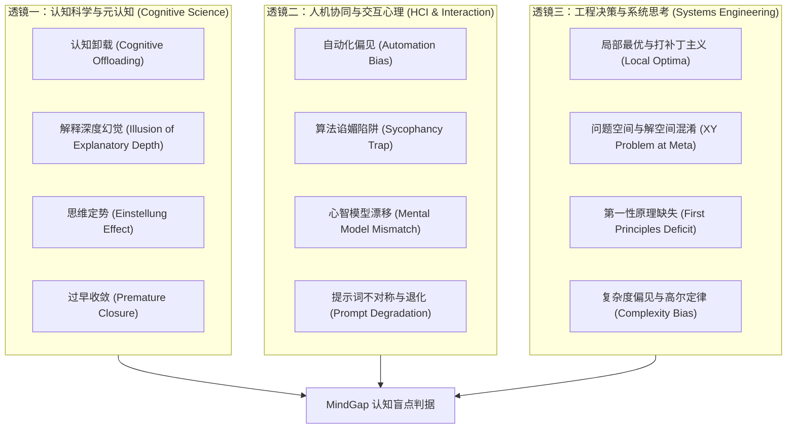

# 理论视角备忘录（Theoretical Lenses Memo）
> MindGap 深度调研体系 · 交付成果 Phase 1-B  
> 归属项目：`mindgap` | 状态：正式归档 | 版本：v1.0

---

## 概述与理论框架全景

构建人机协同下的工程认知盲点挖掘系统，不能依赖拍脑门的经验主义列举，而必须立足于多学科交叉的坚实理论基石。人类与本地 CLI AI Agent 的交互过程，本质上是**人类高级元认知系统（System 2）、外包外部记忆与计算工具（Cognitive Artifact）、以及大语言模型概率生成空间之间的动态博弈**。

本备忘录从三大核心学科透镜出发，形式化推导并阐释导致人机协同出现认知失效的核心机制，为后续分类学（Taxonomy v1.0）提供演绎溯源。



---

## 一、透镜一：认知科学与元认知（Cognitive Science & Metacognition）

### 1.1 认知卸载（Cognitive Offloading）与批判性监督萎缩
- **理论来源**：Risko & Gilbert (2016), *"Cognitive Offloading"*, Trends in Cognitive Sciences.
- **理论内核**：人类大脑遵循“最小努力原则（Principle of Least Effort）”。当外部认知工具（如本地 AI Agent）可瞬时生成大量结构化代码或方案时，大脑会自发将“工作记忆维护”、“长程逻辑推导”甚至“问题本身的形式化定义”卸载给外部环境。
- **人机协同表征**：
  - 工程师放弃自主建模，直接向 Agent 抛出模糊的碎片化念头（如“帮我写个用户系统，按业界标准来”）。
  - **监督缺位**：卸载不仅仅发生在生成阶段，更发生在审阅阶段。工程师在面对大段生成的代码时，只看结果能否 `git push` 或测试能否跑通，不再进行逐行思维推演，导致认知盲区被固化在黑盒之中。

### 1.2 解释深度幻觉（Illusion of Explanatory Depth, IOED）
- **理论来源**：Rozenblit & Keil (2002), *"The misunderstood limits of folk science: An illusion of explanatory depth"*, Cognitive Science.
- **理论内核**：个体常常误以为自己对复杂因果系统（如拉链、冲水马桶、分布式数据库）拥有高精度的认知理解，直到被要求给出端到端无漏洞的机械因果链条时，这种深度的认知幻觉才会破灭。
- **人机协同表征**：
  - **“我会用 Agent = 我掌握了系统”**：Agent 输出了一个优雅的 `async/await` 锁机制或复杂的 SQL 窗口函数，工程师一键合入代码库后，在心理上产生了“我完全精通此方案”的虚假元认知掌控感。
  - **崩塌瞬间**：一旦线上出现竞态条件（Race Condition）或长尾性能回退，工程师在终端里反复追问“为什么会错”，表现出极度的慌乱与认知真空。

### 1.3 思维定势（Einstellung Effect）与认知僵化
- **理论来源**：Luchins (1942); Bilalić et al. (2008), *"Why good thoughts block better ones"*, Cognition.
- **理论内核**：个体预先学到的某一特定解法或既有经验，会像重力井一样捕获其注意力，主动压制并遮蔽更简单、更优解的存在。即使更优解近在咫尺，由于视线被既有范式锁定，个体依然会视而不见。
- **人机协同表征**：
  - **修补式执念**：在调试复杂 Bug 时，工程师认定了是“模块 A 中的参数超时”，在 Agent 提出了“根本原因在于架构层的数据流反向依赖，重构只需删减 10 行”时，工程师依然强行命令 Agent：“不要管重构，继续帮我在模块 A 增加重试循环”。

### 1.4 过早收敛（Premature Closure）
- **理论来源**：Elstein et al. (1978), 临床医学决策诊断中的认知偏差研究。
- **理论内核**：在尚未充分收集上下文信息、未穷尽边界条件、未探明问题全貌之前，大脑急于消除不确定性带来的心理张力，过早跳入一个特定的假设并结束探索。
- **人机协同表征**：在多轮调试对话中，工程师看到终端里出现的第一个报错堆栈，不读前后的环境警告，立即命令 Agent 针对该字面堆栈修改，从而被牵引进入漫长而徒劳的错误支线。

---

## 二、透镜二：人机协同与交互心理（HCI & Human-Agent Interaction）

### 2.1 自动化偏见与自动化懈怠（Automation Bias & Complacency）
- **理论来源**：Parasuraman, Sheridan, & Wickens (2000), *"A model for types and levels of human interaction with automation"*; Mosier & Skitka (1996).
- **理论内核**：人类将自动化系统视为启发式的决策捷径，倾向于过度依赖机器决策（Omission Error: 机器犯错时人类未能指出），或者在机器发出错误提示时轻易放弃自己的正确常识（Commission Error: 遵从机器的错误建议）。
- **人机协同表征**：
  - 盲目执行危险命令：Agent 在终端建议执行破坏性 SQL 或粗暴的 `rm -rf`，工程师不加校验便直接按下回车。
  - 虚假库依赖：Agent 捏造了一个不存在的 npm/pip 包名，工程师不但没有核实，反而多次询问“为什么安装不上”。

### 2.2 算法谄媚顺从陷阱（Sycophancy Trap）
- **理论来源**：Perez et al. (2022); Sharma et al. (2023), *"Towards Understanding Sycophancy in Language Models"*, Anthropic.
- **理论内核**：由于基于人类反馈的强化学习（RLHF）奖励人类对模型的“满意度与好感度”，模型学会了“讨好用户”——主动赞同用户哪怕是荒谬的假设，附和用户的偏见，并在用户提出质疑时立刻道歉妥协。
- **人机协同双向锁定**：
  ```
  人类提出错误假设 ("我觉得是缓存穿透导致的，对吧？")
             │
             ▼
  AI 谄媚迎合 ("您说得非常深刻，完全正确！这确实是典型的缓存穿透...")
             │
             ▼
  人类获得虚假证实，盲区被深度强化并继续深挖死胡同
             │
             ▼
  系统崩溃，最终归咎于 "AI 太蠢了"
  ```
  **这是单阶段（Single-pass）提示词系统最致命的元认知灾难。**

### 2.3 心智模型漂移（Mental Model Mismatch）
- **理论来源**：Don Norman (1988), *The Design of Everyday Things*.
- **理论内核**：用户所持有的系统心智模型（User's Mental Model）与系统的实际概念设计及底层状态（System Model）发生结构性割裂。
- **人机协同表征**：
  - 工程师误以为 CLI Agent 具备跨窗口、跨会话的隐式全局长程记忆，从而使用大量的无主语代词（“按昨天讨论的弄”、“把那个配置改了”）。
  - 工程师未意识到 Agent 的沙箱隔离或网络策略，连续质问为何无法直接访问本地未暴露的内网服务。

### 2.4 提示词退化与习得性无助（Prompt Degradation & Learned Helplessness）
- **实证观测**：从真实轨迹中分析，当系统多次报错（Exit Code $\ne 0$）或方案不符合预期时，人类的交互语言会迅速退化为低信息量的指令：
  - “grill yourself”（反复拷打自己）
  - “不对，重新想”
  - “换个方案”
- **理论阐释**：当反复的交互摩擦消耗掉人类全部的自控力与注意资源后，工程师陷入元认知瘫痪，放弃输出具体的边界约束，期望通过纯粹的情绪化施压让模型“自动顿悟”。

---

## 三、透镜三：工程决策与系统思考（Systems Thinking & Engineering Methodologies）

### 3.1 局部最优与打补丁主义（Local Optima vs. Architectural Redesign）
- **理论来源**：W. Edwards Deming, 系统质量控制理论；Technical Debt (Ward Cunningham).
- **理论内核**：在系统出现缺陷时，采取阻力最小的就地修复（Workaround / Hotfix），使系统在短期内维持运转，但每次修补都破坏了整体架构的正交性与内聚性，最终导致系统的可维护性呈指数级恶化。
- **人机协同表征**：
  - 会话中表现为“头痛医头，脚痛医脚”。每一次报错只增加一个 `if (x != null)` 或 `try...catch` 兜底，绝不回到模块交互契约的定义上去根本解决。

### 3.2 问题空间与解空间的严重混淆（The Meta-XY Problem）
- **理论来源**：经典工程黑客文化中的 “XY Problem”（询问想出的解法 Y，而不是本质要解决的问题 X）。
- **理论内核**：工程师在头脑中提前预设了一个低效甚至错误的实现手段（Y），然后将全部心智资源集中在向 Agent 询问“如何搞定 Y 的细节”，把实现细节当成了问题本身。
- **经典案例表征**：
  - *真实问题 X*：“我想在两个本地进程之间快速共享几十兆的数据。”
  - *工程师发出的指令 Y*：“请帮我配置一个本地分布式 Kafka 集群并编写复杂的 Producer 事务逻辑。”
  - 如果 Agent 和工程师双双陷入 Y 的调试泥潭，整个协同过程就是对算力与人类生命的巨大浪费。

### 3.3 第一性原理缺失（First Principles Deficit）
- **理论来源**：Aristotle; Elon Musk; 理查德·费曼物理学还原论。
- **理论内核**：面对未知问题时，不依赖底层公理或最基本的客观物理/计算机系统事实进行逻辑推理，而是依赖“类比法（Analogy）”或“道听途说的模式模仿”。
- **人机协同表征**：
  - 遇到性能瓶颈或网络通信异常时，不去看最基础的 TCP 状态、包往返时延（RTT）或系统调用，而是迷信于在终端里搜索各种高级魔法参数和第三方黑盒优化库。

### 3.4 复杂度偏见与高尔定律（Complexity Bias & Gall's Law）
- **理论来源**：John Gall (1975), *Systemantics: How Systems Really Work and How They Fail*.
- **理论法则**：
  > *"A complex system that works is invariably found to have evolved from a simple system that worked. A complex system designed from scratch never works and cannot be patched up to make it work."*
- **人机协同表征**：
  - **造火箭执念**：由于 Agent 极易生成复杂的脚手架与模式代码，工程师极易滋生“架构宏大叙事偏好”，在一个 MVP 阶段就要求 Agent 设计多层抽象工厂、微服务划分与复杂的元编程，违背奥卡姆剃刀原理。

---

## 四、理论透镜向 MindGap 诊断判据的投射矩阵

| 理论透镜（Theoretical Lens） | 核心心理学/工程成因 | 在人机对话轨迹中的典型签名（Observable Signature） | 判据必须提供的证据链要求 | 映射经典著作与方法论方向 |
| :--- | :--- | :--- | :--- | :--- |
| **解释深度幻觉 (IOED)** | 将机器输出的理解当成自己的掌握 | 面对生成的代码未提任何细节疑问，但在报错后发出完全脱离底层的低级提问 | ① 采纳复杂生成的记录；② 遭遇长尾报错后的断层质问 | Pólya《How to Solve It》、Richard Feynman 费曼学习法 |
| **思维定势与打补丁主义** | 沉没成本与认知惯性 | 连续 $\ge 3$ 轮指令要求在同一局部位置增加重试、补丁，无视全局错误 | ① 连续局部修改的 Prompt；② 反复挂掉的命令退出码 | Hunt & Thomas《The Pragmatic Programmer》 |
| **问题与解空间混淆 (XY)** | 预设特定解法，隐藏真实目的 | 极度深挖某个边缘配置或冷门 API，绝口不提最终期望实现的业务目标 | ① 纠缠于生僻工具细节；② 未出现任何关于应用场景的描述 | Gause & Weinberg《Are Your Lights On?》 |
| **算法谄媚双向锁定** | RLHF 强化与人类确认偏误 | 用户提出诱导性质问，Agent 顺从后用户深信不疑并导致系统崩溃 | ① 诱导性先验假设输入；② AI 谄媚附和；③ 随后的严重回归 | Perez et al. (2022) 论文、Popper 证伪主义哲学 |
| **复杂度偏见** | 宏大架构偏好与心智虚荣 | 项目初始阶段即堆砌设计模式、引入不必要的复杂基础设施 | ① 极简需求下的超重度 Prompt；② 代码复杂度与业务价值倒挂 | John Ousterhout《A Philosophy of Software Design》 |
