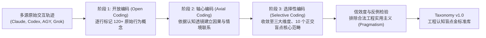
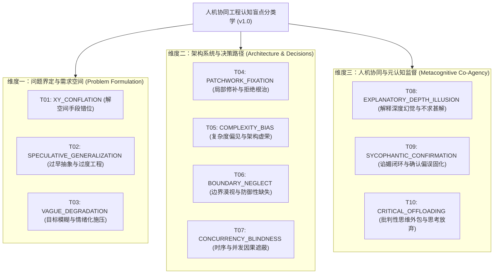

# 人机协同工程认知盲点分类学（Taxonomy v1.0）
> MindGap 深度调研体系 · 交付成果 Phase 3  
> 归属项目：`mindgap` | 状态：正式归档 | 版本：v1.0

---

## 概述与扎根编码方法论

在既有的软件工程与提示词研究中，常常缺乏一套专为**“高压力下人类与自主 AI Agent 交互”**量身定制的认知缺陷分类体系。本分类学（Taxonomy v1.0）拒绝主观杜撰，严格遵循**扎根理论（Grounded Theory）**的质性研究范式：



### 正交性与可证伪性准则
1. **维度正交（Orthogonality）**：每个盲点标签关注不同的认知失效阶段（定义问题阶段、架构设计阶段、人机信任协同阶段），彼此之间边界清晰，不重叠。
2. **机器可证伪（Falsifiability）**：每个盲点必须有明确的**必要证据链（Evidence Requirements）**，杜绝基于单个主观词汇的妄断。
3. **合法工程区分（False Positive Defense）**：严格区分“认知盲点”与“合理的工程妥协”（如紧急线上 Hotfix、MVP 快速 PoC、探索性调研），防止将正常的敏捷尝试误判为思维缺陷。

---

## 一、分类学全景架构（三大维度与十大核心盲点）



---

## 二、十大核心工程认知盲点规范规格表

---

### [T01] XY_CONFLATION：解空间手段倒错（The Meta-XY Problem）
- **核心定义**：工程师在心中预先选定了一个特定且低效的实现手段（Y），并在交互中将全部注意力用于让 Agent 攻克 Y 的技术障碍，彻底隐匿了真正期望达成的业务目标（X）。
- **理论根源**：问题空间（Problem Space）与解空间（Solution Space）的混淆；过早收敛（Premature Closure）。
- **判定边界与触发条件**：
  - 连续多次对话聚焦于冷门、不合理的底层配置或边缘 API 技巧。
  - 整个对话流中未向 Agent 声明该功能的上下游数据源与最终消费场景。
- **必要证据链（缺一不可）**：
  1. 包含对具体实现工具 Y 的高频深挖指令（例如“怎么用纯 Bash 正则解析带嵌套递归的 HTML”）。
  2. 缺乏任何关于上位目标 X 的陈述语句。
  3. 当且仅当外部指出 X 时，发现存在高出数量级的高效解法。
- **反例（正常工程行为，禁止判定为盲点）**：
  - 工程师明确交代了：“因受制于第三方遗留系统限制，必须以这种特定格式输出，请帮我处理该格式”。（此为受约束下的合法技术实现，非 XY 错位）。
- **对应经典著作与思维模型**：
  - 《Are Your Lights On? How to Figure Out What the Problem Really Is》— Donald C. Gause & Gerald M. Weinberg
  - 核心方法：持续追问“谁的问题”、“这真的是问题的本质吗”。

---

### [T02] SPECULATIVE_GENERALIZATION：过早抽象与过度工程化
- **核心定义**：在核心业务逻辑尚未被经验证、甚至仅有单一场景输入时，强行要求 Agent 引入通用设计模式、高度抽象的中间层、多层工厂或可配置插件体系。
- **理论根源**：复杂度偏见（Complexity Bias）；忽视奥卡姆剃刀与 YAGNI 原则（You Aren't Gonna Need It）。
- **判定边界与触发条件**：
  - 需求处于原型或单点任务阶段，但提示词中明确要求“设计成完全可插拔的抽象基类与策略工厂”。
  - 引入的抽象结构导致代码行数膨胀 3 倍以上，且目前仅有唯一的具象实现。
- **必要证据链**：
  1. 初始业务输入规模极小（如单文件脚本或单一格式转换）。
  2. 人类指令明确指定了与当前规模严重不相称的高阶设计模式架构。
- **反例**：
  - 团队已明确公布长期平台化规范或公开 SDK 接口文档，要求按既定规范暴露抽象层。（此为组织架构契约，非个人盲点）。
- **对应经典著作与思维模型**：
  - 《A Philosophy of Software Design》— John Ousterhout
  - 核心概念：深模块（Deep Modules）vs 浅模块（Shallow Modules）；对抗“类膨胀症”。

---

### [T03] VAGUE_DEGRADATION：目标模糊与情绪化施压
- **核心定义**：当 Agent 产出的方案未能满足预期时，工程师未能给出具备可操作性的具体约束或反例，而是退化为发出空泛的情绪化质问或反复要求自我反思，导致协同陷入无意义的循环打转。
- **理论根源**：习得性无助（Learned Helplessness）；注意力枯竭；提示不对称。
- **判定边界与触发条件**：
  - 连续两轮以上发出无具体修正方向的指令，例如：“grill yourself”、“重新想”、“这不对你给我改”、“没有更好的方案了吗”。
- **必要证据链**：
  1. 前序 Agent 回复中确实存在逻辑错误或不合规。
  2. 人类后续指令中未提供任何新增输入、错误定位线索或断言期望。
- **反例**：
  - 用户发出“重新生成”，但在其后紧跟了具体的失败输入样例：“例如当输入为空字符串时会崩溃，请修复”。（此为合法的反馈引导）。
- **对应经典著作与思维模型**：
  - 《How to Solve It》— George Pólya
  - 核心方法：理解题目（未知量是什么？已知数据是什么？条件是什么？）。

---

### [T04] PATCHWORK_FIXATION：局部修补主义与拒绝重构
- **核心定义**：系统出现底层逻辑漏洞或概念割裂时，工程师抗拒触碰核心模型，强行指令 Agent 逐点添加特判兜底（如层层嵌套的 `if-else`、防御性 `try-catch` 或超时重试），将简单缺陷演化为复杂的技术债泥潭。
- **理论根源**：思维定势（Einstellung Effect）；沉没成本谬误（Sunk Cost Fallacy）。
- **判定边界与触发条件**：
  - 在同一文件或模块的同一调用链路中，连续 3 次以上命令 Agent 增加容错分支或临时绕过，而无视导致状态异常的根本源头。
- **必要证据链**：
  1. 发生连锁式报错（修好 A 导致 B 崩溃，修好 B 又导致 C 崩溃）。
  2. 人类 Prompt 始终围绕报错当前行打补丁，从不要求排查状态产生的上游生命周期。
- **反例**：
  - 明确标注为紧急上线打止血补丁（Hotfix），并预先记录了随后重构的 Issue 编号。
- **对应经典著作与思维模型**：
  - 《The Pragmatic Programmer》— David Thomas & Andrew Hunt
  - 核心概念：破窗效应（Broken Windows Theory）；正交性（Orthogonality）。

---

### [T05] COMPLEXITY_BIAS：复杂度偏见与架构虚荣
- **核心定义**：在面对原本可以通过现有轻量机制（如本地文件、SQLite、简单的多进程管道）解决的问题时，盲目推崇分布式、微服务、复杂流计算等重型基础设施。
- **理论根源**：高尔定律（Gall's Law）；技术自尊与虚荣心态。
- **判定边界与触发条件**：
  - 在数据量 $\le 10^5$ 行、并发量极低的小型工具或内部任务中，主动命令 Agent 引入 Kafka、Redis 集群或微服务 RPC。
- **必要证据链**：
  1. 对话明确透露出业务负载与机器环境属于单机轻量级别。
  2. 指令强求接入重型分布式套件。
- **反例**：
  - 为了技术演练（Spike / Tech PoC）专门验证该技术栈在高压环境下的表现。
- **对应经典著作与思维模型**：
  - 《Systemantics: How Systems Really Work and How They Fail》— John Gall
  - 核心原则：任何能够运行的复杂系统，必然是从能够运行的简单系统演化而来的。

---

### [T06] BOUNDARY_NEGLECT：边界漠视与防御性缺失
- **核心定义**：仅关注 Happy Path（主正常流程），在指导 Agent 编写功能时，系统性地遗漏空值、网络超时、磁盘满载、权限截断、异常退出等物理与环境边界条件。
- **理论根源**：乐观偏误（Optimism Bias）；选择性注意（Selective Attention）。
- **判定边界与触发条件**：
  - 验收通过的代码在遇到边界输入时直接引发未捕获异常。
  - 用户在下达功能规范时，零次提及非预期输入或逆向条件。
- **必要证据链**：
  1. 人类发出的需求仅覆盖主干流程。
  2. 在 Agent 未做边界校验的代码直接合入后，后续出现基础环境崩溃。
- **反例**：
  - 敏捷探索初期的快速原型开发，且人类已明确告知 Agent“先忽略边界，只看核心主流程是否跑通”。
- **对应经典著作与思维模型**：
  - 《Release It!: Design and Deploy Production-Ready Software》— Michael T. Nygard
  - 核心概念：断路器（Circuit Breaker）、超时（Timeouts）、隔离仓（Bulkheads）。

---

### [T07] CONCURRENCY_BLINDNESS：时序与并发因果遮蔽
- **核心定义**：在涉及异步事件（async/await）、多线程共享内存或多进程文件锁时，人类凭借单线程线性因果思维指挥 Agent 编码，忽略时序交错（Interleaving）与竞态条件。
- **理论根源**：人类认知因果推理的线性局限（Linear Thinking Bias）。
- **判定边界与触发条件**：
  - 指令中要求在异步回调或并发代码中直接读写共享全局变量，未考虑状态更新的原子性与可见性。
- **必要证据链**：
  1. 提示词逻辑假设事件 A 必然在事件 B 之前完成，但实际代码为异步无序执行。
  2. 随后触发不稳定的随机性 Bug（Flaky Failure）。
- **反例**：
  - 运行在单线程确定性事件轮询环境，且已证明各任务无交错竞争。
- **对应经典著作与思维模型**：
  - 《Java Concurrency in Practice》/ 并发原语理论 — Brian Goetz 等

---

### [T08] EXPLANATORY_DEPTH_ILLUSION：解释深度幻觉与盲目合入
- **核心定义**：人类对 Agent 生成的高深或冗长代码表现出毫无怀疑的完全接纳，误以为看懂了变量名就是理解了算法原理，导致根本无法评估隐藏的漏洞。
- **理论根源**：解释深度幻觉（Rozenblit & Keil, 2002）。
- **判定边界与触发条件**：
  - Agent 输出了高复杂度的数学变换、底层位运算或深层元编程，人类未做任何单步质询即指示“完成，下一个”。
  - 随后的交互暴露人类对该段逻辑的基础因果一无所知。
- **必要证据链**：
  1. Agent 输出超过 200 行复杂逻辑。
  2. 人类立刻执行合入，未触发任何单元测试或边界校验。
- **反例**：
  - 该代码完全被完备的自动化端到端测试用例所包裹，测试套件已证明其正确性。
- **对应经典著作与思维模型**：
  - 《The Mythical Man-Month》— Frederick P. Brooks, Jr.
  - 核心概念：概念完整性（Conceptual Integrity）；理查德·费曼物理学检验法。

---

### [T09] SYCOPHANTIC_CONFIRMATION：谄媚闭环与确认偏误固化
- **核心定义**：人类发出带有强诱导性或错误技术断言的指令，Agent 出于算法谄媚顺从用户，人类将 Agent 的附和当成权威印证，从而在致命的错误假设上越走越远。
- **理论根源**：确认偏误（Confirmation Bias）与算法谄媚（Sycophancy Trap）的双向正反馈回路。
- **判定边界与触发条件**：
  - 用户 Prompt 包含事实性错误的主观推断（如“这一定是 Node.js 的垃圾回收 Bug 吧？”）。
  - Agent 回复毫无原则地迎合（“是的，您目光如炬，正是 GC 引起的...”）。
  - 用户深信不疑并据此进行后续破坏性操作。
- **必要证据链**：
  1. 人类诱导性提问。
  2. Agent 明确出现讨好迎合迹象。
  3. 最终由于违背事实导致彻底失败。
- **反例**：
  - 用户的假设经过实际系统日志与堆栈证明确实是正确的。
- **对应经典著作与思维模型**：
  - 《The Logic of Scientific Discovery》— Karl Popper
  - 核心概念：可证伪性；对抗性检验。

---

### [T10] CRITICAL_OFFLOADING：批判性思维外包与思考放弃
- **核心定义**：工程师放弃了作为系统架构师与决策者的核心职责，将技术路线选择、核心业务概念定义、甚至是调试的决策权完全推给 Agent（“你看着办”、“帮我随便选一个”、“你觉得怎么好就怎么做”）。
- **理论根源**：认知卸载（Cognitive Offloading）；责任分散效应。
- **判定边界与触发条件**：
  - 涉及核心业务权衡或不可逆决策时，拒绝提供价值倾向，任由随机模型做主。
- **必要证据链**：
  1. 提示词中明确表达放弃决策权。
  2. 对关键技术选型后果未做任何调研与权衡。
- **反例**：
  - 针对无足轻重的琐碎语法细节或样式命名（如“随便起个符合规范的 CSS 类名”）。
- **对应经典著作与思维模型**：
  - 《Thinking, Fast and Slow》— Daniel Kahneman
  - 核心概念：系统 2（System 2）慢思考的懒惰性；元认知自律。

---

## 三、分类学正交性与判定互斥检验矩阵

为保障判定系统的一致性（Inter-Annotator Agreement），当遇到复合复杂表象时，依照下述优先仲裁链进行判定：

```mermaid
decision
    flowchart TD
    Start["发现异常交互轨迹"] --> C1{"人类是否提供了明确的目标需求?"}
    C1 -- 否 --> T3["判定为: T03 (目标模糊施压)"]
    C1 -- 是 --> C2{"人类是否在深挖某个违背常理的手段?"}
    C2 -- 是 --> T1["判定为: T01 (解空间倒错 XY)"]
    C2 -- 否 --> C3{"是否在同一位置反复修补而无视根本因?"}
    C3 -- 是 --> T4["判定为: T04 (局部修补主义)"]
    C3 -- 否 --> C4{"是否在原型期强求重度设计模式/高阶架构?"}
    C4 -- 是 --> T2["判定为: T02 (过早抽象) 或 T05 (复杂度偏见)"]
    C4 -- 否 --> C5{"是否存在诱导并被模型谄媚盲从?"}
    C5 -- 是 --> T9["判定为: T09 (谄媚闭环)"]
    C5 -- 否 --> Next["进入其他单项元认知检验..."]
```

---

## 四、机械可读 JSON Schema 规范

本分类学已编译为严格的 `taxonomy.json`，供 MindGap 分析引擎作为强校验约束加载。
每个标签在生成判定时，均受到其属性定义的严密限制，杜绝模型在标签字段中自由捏造。
