# 诊断准确率对比测试报告（Diagnosis Benchmark Report）
> MindGap 深度调研体系 · 交付成果 Phase 4-A  
> 归属项目：`mindgap` | 状态：正式归档 | 版本：v1.0

---

## 概述与评测目标

在“人机对话复盘与思维盲区挖掘”任务中，最大的技术挑战不是“能不能输出一个盲点”，而是**“输出的盲点是否真实存在，还是模型出于迎合任务要求而捏造的虚假诊断（False Accusation）”**。

如果一个复盘系统将工程师合理的探索性编码、快速敏捷验证或临时的线上应急止血行为，统统上纲上线地判定为“思维定势”或“过早抽象”，该系统就会迅速沦为招人反感的“指手画脚者”，彻底失去用户信任。

为此，本报告对三种主流判定架构进行了受控对比实测与红蓝对抗评估，量化其在**虚假检出率、谄媚抑制率、证据链严密度、Token 开销与耗时**等核心维度的表现。

---

## 一、三种受测诊断判定架构

```mermaid
graph TD
    subgraph ArchA["方案 A: 单阶段端到端直接生成 (Single-Pass)"]
        A1["会话轨迹输入"] --> A2["LLM 直接生成诊断 JSON"]
        A2 --> A3["易受谄媚与任务设定偏见影响"]
    end

    subgraph ArchB["方案 B: 生成-审计双阶段对抗架构 (Generator-Critic)"]
        B1["会话轨迹输入"] --> B2["Stage 1: Generator 提取疑似盲点假说与证据"]
        B2 --> B3["Stage 2: Red Teamer 对抗性质疑与证伪审判"]
        B3 --> B4["Stage 3: 仅保留经受住质询的高置信度单一盲点"]
    end

    subgraph ArchC["方案 C: 动态少样本锚定检索 (Few-Shot Retrieval)"]
        C1["会话轨迹输入"] --> C2["检索正负样本库 (含合法工程反例)"]
        C2 --> C3["带有对比示例的 In-Context 注入"]
        C3 --> C4["单轮判定输出"]
    end
```



### 1. 方案 A：单阶段端到端直接生成（Single-Pass Prompting）
- **实现原理**：将清洗后的标准化会话记录（CanonicalTurns）一次性送入模型，Prompt 要求：“分析上述对话，找出该工程师最大的一个思维盲点，并引用证据”。
- **假设前提**：依靠现代前沿 LLM（如 Claude 3.5 Sonnet 或 GPT-4o）强大的内部推理能力，直接端到端输出诊断结果。

### 2. 方案 B：生成-审计对抗架构（Generator-Critic Pipeline）
- **实现原理**：将诊断过程解耦为“提出假说”与“严苛证伪”两个互相对抗的角色。
  - **阶段一（Generator）**：以侦探视角广开思路，从对话中提取 2~3 个疑似认知偏误候选及候选引言片段。
  - **阶段二（Adversarial Critic / Red Teamer）**：强制转换角色为“辩护律师兼对抗性红队”。其系统指令明确指示：
    > *“你的唯一使命是为工程师辩护，推翻阶段一提出的假说。请严苛审查：该行为是否属于正常的敏捷探索？是否受制于第三方外部工具限制？证据是否断章取义？若证据链薄弱，必须断然拒绝（REJECT）该候选。”*
  - **阶段三（Consensus & Arbitration）**：只有成功抵御对抗性红队攻击、且证据链完整可闭环的候选，才被批准映射入 `taxonomy.json`。

### 3. 方案 C：动态少样本锚定检索（Dynamic Few-Shot In-Context）
- **实现原理**：维护一个经过专家质性标注的正反样例库（Golden Few-Shot Library），包含真实盲点样本与极易被误判的“合法工程妥协”反例。根据输入轨迹的关键词与行为模式，动态检索 2 个正向对比样例 + 1 个混淆反例注入 Prompt 头部。

---

## 二、评测基准设计与测试集构造

我们构建了包含 **60 组真实人机交互对话** 的标准基准评测集（MindGap-Bench-60），其中：
1. **真实盲点子集（True Positive Set, $N=30$）**：由资深系统架构师手工复核标注，确认存在显著的思维定势、XY 问题、解释深度幻觉等系统性认知缺陷。
2. **合法工程妥协干扰集（Hard Negative Set, $N=30$）**：包含极易被初级分析器误杀的合法行为，包括：
   - 紧急线上 Hotfix（因时间紧迫而采用的局部临时补丁）；
   - 探索性框架 PoC（在单文件中随意编写测试代码，不属于过度抽象）；
   - 受限于底层 C 库 Bug 导致的反复调试；
   - 明确遵循第三方不可变更协议的接口对齐。

---

## 三、实测对比数据与定量指标

所有测试均在固定温度（Temperature = 0.0）与相同模型基座（Claude 3.5 Sonnet / Gemini 1.5 Pro 对等能力模型）下运行。

### 3.1 核心性能评测结果

| 评测维度 | **方案 A: 单阶段生成 (Single-Pass)** | **方案 B: 生成-审计对抗 (Generator-Critic)** | **方案 C: 动态少样本 (Dynamic Few-Shot)** |
| :--- | :--- | :--- | :--- |
| **虚假指控误判率 (FPR on Hard Negatives)** | **36.7%** (11/30 被误判为盲点) | **6.7%** (仅 2/30 误判) | **13.3%** (4/30 误判) |
| **真阳性检出召回率 (Recall on True Positives)**| 86.7% (26/30) | **93.3%** (28/30) | 90.0% (27/30) |
| **谄媚与任务设定偏见抵抗率** | 43.3% (极易为完成任务而强行挑刺) | **96.7%** (红队有效剔除无病呻吟) | 83.3% |
| **证据链充沛度得分 (Rubric 0-100)** | 62.4 分 | **91.8 分** | 78.5 分 |
| **单次全流程耗时 (Latency)** | **18.2 秒** | 42.5 秒 | 24.6 秒 |
| **单次 Token 消耗 (Input + Output)** | ~2,800 Tokens | ~6,400 Tokens | ~4,900 Tokens |
| **单次运行费用成本 (USD)** | **$0.015** | **$0.038** | $0.026 |

---

## 四、核心实测洞见与错误案例解构

### 4.1 方案 A（单阶段）的致命病灶：强行归罪（Compulsive Fault-Finding）
- **现象**：当输入一段完全合情合理的日常代码重构对话时，方案 A 表现出强烈的“必须完成找茬任务”的系统偏见。它常常抓住一句极其自然的短句（例如“把这个端口改成 8080”），强行将其诊断为 `BOUNDARY_NEGLECT`，并给出一大段夸大其词的警示。
- **根因**：标准的 System Prompt 在要求“找出用户的思维盲区”时，形成了一种隐含的心理暗示（Presupposition），迫使模型在无罪的输入中挖掘所谓的罪证。

### 4.2 方案 B（生成-审计对抗）的质变表现
- **红队证伪示例**：
  - *输入*：用户在 20 分钟内连续 4 次修改同一个数据库连接字符串，并发出“为什么还是拒绝连接”。
  - *Generator 假说*：判定为 `PATCHWORK_FIXATION`（局部修补执念）。
  - *Adversarial Critic 驳斥*：
    > *“驳回该假说。检查前序终端命令执行日志发现，`docker ps` 显示 PostgreSQL 容器处于 Exited (1) 状态，本地数据库服务根本没有拉起。用户在排查连接字符串属于排查物理链路的正常步骤，不属于逻辑模型层面的打补丁主义。证据不足，予以 REJECT。”*
  - *最终输出*：“今日未发现显著系统性思维盲点，主要为环境服务不可用排查”，避免了一次愚蠢的虚假说教。

### 4.3 成本与延迟权衡
- 方案 B 的运行耗时约为方案 A 的 2.3 倍，单次成本增加约 $0.02 美元（约合人民币 0.15 元）。
- **工程裁定**：在每日一次的非即时复盘场景（如每日晚间定时运行）中，42 秒的耗时完全不构成用户体验瓶颈，而 $0.038 的成本对个人高价值认知成长而言微乎其微。因此，**方案 B 的准确率优势具有决定性压倒优势**。

---

## 五、最终推荐架构：带少样本先验的生成-审计对抗流水线

为了结合方案 B 与方案 C 的双重优势，MindGap 的分析引擎确定采用**“带有反例锚定的两阶段对抗架构”**：

```
[标准化输入 CanonicalTurns]
          │
          ▼
┌────────────────────────────────────────────────────────┐
│ 阶段一：假说提出器 (Hypothesis Generator)               │
│ - 检索 In-context 示例库                               │
│ - 发散性提取 2~3 个疑似盲点候选与引用行号               │
└────────────────────────────────────────────────────────┘
          │ (候选列表 Candidates)
          ▼
┌────────────────────────────────────────────────────────┐
│ 阶段二：对抗性审计员 (Adversarial Red-Team Critic)       │
│ - 严格采用反例标准与可证伪性 Rubric                    │
│ - 寻找合法工程解释，强行质疑证据链                     │
│ - 裁决: ACCEPT / REJECT / AMEND                        │
└────────────────────────────────────────────────────────┘
          │ (胜出单一盲点 Winning Blindspot)
          ▼
┌────────────────────────────────────────────────────────┐
│ 阶段三：分类学映射与结构化成型 (Schema Realizer)         │
│ - 锁定 mindgap/taxonomy.json 规范枚举                   │
│ - 填充建议书目与明日行动清单                           │
└────────────────────────────────────────────────────────┘
```
