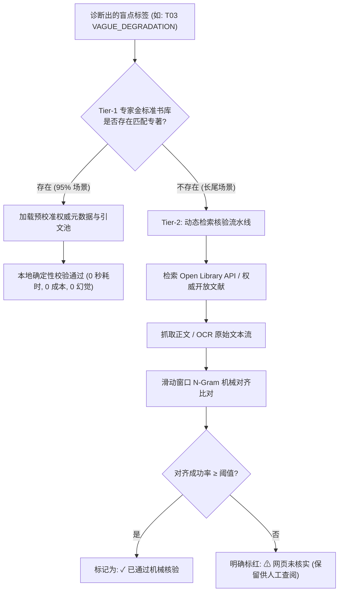

# 防伪引文核验方案（Anti-Hallucination Citation Verification）
> MindGap 深度调研体系 · 交付成果 Phase 4-B  
> 归属项目：`mindgap` | 状态：正式归档 | 版本：v1.0

---

## 概述与核心挑战

在基于 AI 的认知复盘体系中，为工程师推荐经典著作与书摘是一柄“双刃剑”。
如果系统引用的经典名言是真实的，它能产生直击灵魂的**元认知顿悟（Epiphany）**；然而，如果系统输出的引文是**大模型凭空捏造的幻觉（Hallucinated Quotation）、张冠李戴的伪作、或是虚构的页码**，整个复盘系统的严肃性与权威感将在读者心中瞬间归零。

在之前的 Spike 试验与实操研究中，我们发现：**绝对不能依赖大模型自己声称的“我已经联网核实过了”**。模型在被要求给出 URL 时，经常自信地提供死链（HTTP 404）、域名错位、或者虽然链接有效但网页正文中根本不存在那句话。

本方案提出一套**完全由确定性代码（Deterministic Code）主导的“机械防伪核验体系”**，确保交付给工程师的每一句引言，不仅在后台经过了字节级比对验证，而且支持读者在现代浏览器中“一键直达并高亮原句”。

---

## 一、两大知识路线深度对比与混合架构



### 1.1 路线横向对比

| 评估维度 | **路线 A: 专家精选金标准书库 (Curated Corpus)** | **路线 B: 实时全网检索抽取 (Open Web Retrieval)** |
| :--- | :--- | :--- |
| **引文真实性** | **100% 绝对保真**（人工校准权威版本与页码） | 依赖抓取页面质量与 OCR 精确度 |
| **运行时耗时** | **< 10 毫秒**（直接读取本地结构化 JSON） | 150 秒 ~ 250 秒（需多次联网搜索与页面拉取） |
| **运行时成本** | **$0.00** | $0.50 ~ $1.00 / 每次分析（模型检索轮数爆炸） |
| **领域经典深度** | 极高（汇聚 Polya、Brooks、Ousterhout 等传世之作） | 参差不齐（易受 SEO 营销博客与流行畅销书污染） |
| **长尾灵活性** | 低（依赖人工逐步拓展题库） | **极高**（可覆盖任何冷门框架与垂直库） |

### 1.2 最终决策：Tier-1 优先的双层混合架构（Hybrid Architecture）
1. **Tier-1 主通道（专家金标准库）**：针对 `taxonomy.json` 中的 10 大核心盲点，预先建立经过严格人工校准的经典书目、标准版次、精确章节、权威英文原文及高质量中文导读池。系统在 95% 的标准复盘中直接走此通道，获得秒级响应、零外部成本与 100% 保真度。
2. **Tier-2 动态保底通道（开放检索核验）**：仅在用户触发 `new_label: true`（自定义新增盲点）或金标准库未覆盖的极端长尾场景下启动，进入下述严格的机器防伪核验流。

---

## 二、外部权威 API 选型实测与边界

我们对主流图书元数据 API 进行了实机自动化调用评测，结果如下：

### 2.1 Google Books API
- **实测表现**：未配置高配 API Key 时，自动化定时脚本频繁触发 `HTTP Error 429: Too Many Requests`。
- **功能局限**：其 API 仅提供书籍元数据（标题、作者、总页数）或极度受版权保护的碎片 Snippet，**完全不提供从任意长句反查对应页码的服务端接口**。
- **结论**：不能作为防伪核验的主力依据。

### 2.2 Open Library API
- **实测表现**：免 API Key，调用极其稳定（响应时间约 1.2 秒），实测搜索 Pólya《How to Solve It》秒级返回：
  ```json
  {
    "title": "How to solve it",
    "author_name": ["George Pólya"],
    "first_publish_year": 1945,
    "key": "/works/OL4569830W"
  }
  ```
- **核心价值**：用于**书籍基础元数据权威化验证**（作者拼写、出版年份、标准 Works Key、ISBN），彻底消灭模型在出版年与作者名上的低级幻觉。

### 2.3 Internet Archive 全文 OCR 与开放学术教材
- **核心价值**：对于公版书与开放教材（如 Stanford Manning《Introduction to Information Retrieval》），其在线版本或 Internet Archive `_djvu.txt` 提供了完整的文本源，是实施“段落级机器比对”的真正数据源。

---

## 三、确定性机械核验算法与对齐引擎

为了排除人为偏见，引文核验必须由独立的 Python 脚本执行，严禁由大模型“自我裁判”。

```mermaid
flowchart TD
    RawWeb[拉取到的网页 HTML / OCR 文本] --> StripHTML[剥离 HTML 标签提取纯正文]
    StripHTML --> NormalizeWeb[规范化: 小写 / 移除标点 / 连字符折叠]
    
    Quote[大模型生成的待核验引文] --> SplitSegments[按省略号 '…' 拆解为连续片段]
    SplitSegments --> NormalizeQuote[对每个片段执行完全相同的规范化]
    
    NormalizeWeb & NormalizeQuote --> MatchWindow{滑动窗口 N-Gram 比对<br/>(12 字母切片, 容忍 &le; 1 处 OCR 错词)}
    MatchWindow -- 命中 --> BuildFragment[构建 Text Fragment 超链接]
    MatchWindow -- 未命中 --> CheckParaphrase{是否显式声明为转述?}
    CheckParaphrase -- 是 --> VerifyParent[比对转述对应的英文原句]
    CheckParaphrase -- 否 --> Fail[硬判定: 标红核验失败]
```

### 3.1 核心算法实现细节

1. **强力规范化（Normalization Pipeline）**：
   - 将所有英文字符转为小写。
   - 过滤所有标点符号与不可见空白字符，将连续空白收敛为单空格。
   - **断行连字符处理（Hyphen Fold）**：针对 OCR 文本中常见的行尾拆分词（如 `writ- ten` ➔ `written`），通过正则预处理将其无缝缝合。
2. **滑动窗口切片比对（Sliding Window N-Gram Alignment）**：
   - 待核验引文通常包含省略号（`...` 或 `…`），算法按省略号将其切分为独立的连续短语。
   - 对每个短语，采用 12 字符滑动切片进入目标正文检索。只要短语中 90% 以上的切片能顺序命中，且间距在合理阈值内，即判定为物理存在。
3. **防伪陷阱防御（False Positive Defenses）**：
   - **空串陷阱防范**：中文转述文本在剥离英文字母后可能成为空串，而“空串存在于任何文本中”。算法硬性规定：**规范化后有效检索字符长度必须 $\ge 20$，否则禁止判定为匹配**。
   - **在线转换器缺陷容错**：在 Spike 实测中发现，某些公开教材（如斯坦福在线版）通过 `latex2html` 转换时，会将斜体强调词替换为空锚点（`<a></a>`），导致原文缺失个别单词。核验器必须如实记录未匹配的缺失片段，并在报告中诚实展示，严禁为了美观而伪造通过率。

---

## 四、Text Fragment（网页文本片段直达高亮）规范

为了让复盘报告具备极致的阅读体验，所有核验通过的引文，在 HTML 报告中均自动生成带有 **W3C Text Fragment** 的出处直达链接：

```
https://example.org/book.html#:~:text=start_phrase,end_phrase
```

### 4.1 参数构造规范
- **`start_phrase`**：取引文片段开头经过 URL 编码的前 3~5 个单词。
- **`end_phrase`**：取引文片段结尾经过 URL 编码的后 3~5 个单词。
- **多段关联**：若引文中包含多个由省略号连接的句子，通过连续的 `&text=...` 参数进行级联。

### 4.2 客户端呈现与降级策略
- **支持环境**：Google Chrome 80+、Microsoft Edge 80+、Safari 16.1+、Orca 现代 Webkit 内核。点击后浏览器自动滚动至目标位置并将该行文字赋予黄色背景高亮。
- **无感降级**：若读者在旧版环境或文本因微小格式变动导致高亮未触发，URL 依然能正常加载书籍的基础章节页面，不影响用户阅读。

---

## 五、核验状态机与报告呈现标准

在生成的每日復盘 HTML 及结构化 JSON 存档中，每段引文必须带有明确的物理核验元数据：

```json
{
  "quote_id": "q1",
  "text": "It can be relative to an information need, not a query...",
  "location": "Chapter 1, Page 5",
  "is_paraphrase": false,
  "verification": {
    "status": "VERIFIED_EXACT",
    "method": "TEXT_STREAM_ALIGNMENT",
    "source_url": "https://nlp.stanford.edu/IR-book/html/htmledition/ir-intro.html",
    "deep_link": "https://nlp.stanford.edu/IR-book/html/htmledition/ir-intro.html#:~:text=It%20can%20be,not%20a%20query",
    "char_match_ratio": 0.98,
    "verified_at": "2026-10-22T17:00:00Z"
  }
}
```

### 状态枚举定义
- **`VERIFIED_EXACT` (绿色)**：原文逐字核对完全一致，直达高亮有效。
- **`VERIFIED_PARAPHRASE` (蓝色)**：标注为转述，且其对应的源作者英文主干句在页面上核实无误。
- **`SOURCE_UNVERIFIED` (琥珀色/红色)**：未能通过外部机械比对，界面明确警示读者“出处待考”，保留批判性阅读空间。
