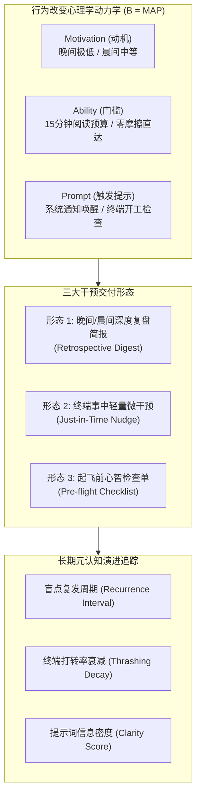
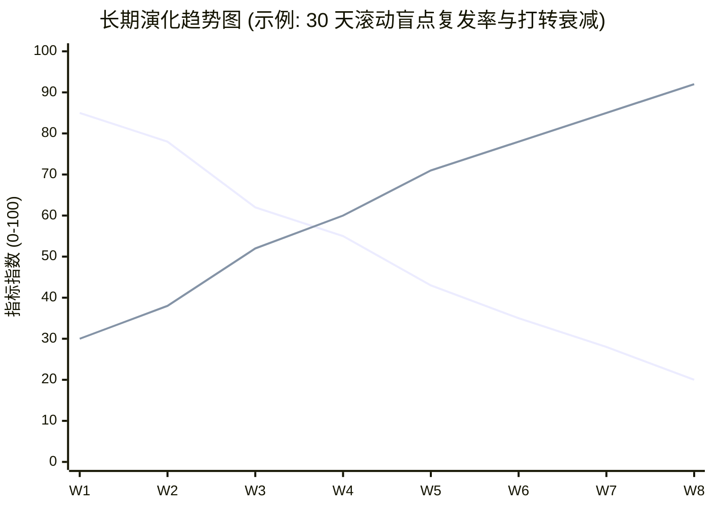

# 认知干预体验设计规范（Intervention & Behavioral Change）
> MindGap 深度调研体系 · 交付成果 Phase 5-A  
> 归属项目：`mindgap` | 状态：正式归档 | 版本：v1.0

---

## 概述与行为心理学公理

构建一套思维盲区挖掘系统，最危险的归宿是变成一个**“技术上很精妙，但用户看两天就烦了并将其永久归档到垃圾桶”**的自嗨玩具。

工程师在经历了全天高强度的代码搏杀后，其意志力与心理能量（Ego Depletion）处于近乎枯竭的状态。任何要求其付出重度认知努力、强行灌输说教的干预方式，都会遭遇大脑自发性的防御性排斥。

本规范立足于**福格行为模型（BJ Fogg Behavior Model）**、**认知负荷理论（Cognitive Load Theory）**以及**反馈衰减规律（Feedback Decay Law）**，对干预形态进行科学解构与体验工程化定义。



---

## 一、行为心理学三大公理在工程复盘中的映射

### 1. 福格行为模型：$B = M \cdot A \cdot P$
- **$M$（Motivation，动机）**：工程师希望在技术架构上持续精进，但痛恨空洞的道德说教与技术指责。复盘内容必须具备极高的**“顿悟浓度”**与**“明天立即可用的行动抓手”**，将“指责”重塑为“赋予超能力”。
- **$A$（Ability，能力/执行门槛）**：
  - **时间预算刚性约束**：单篇报告中文正文严格控制在 3,000 ~ 5,000 字内，阅读总时长硬性锚定在 **10 ~ 15 分钟**。严禁产出万字长篇大论。
  - **零网络摩擦与零登录**：纯本地 HTML 单文件，所有 CSS 与矢量图内嵌，无须打开第三方平台，断网即可毫秒级渲染。
- **$P$（Prompt，触发提示）**：利用 macOS 确定性系统通知在非侵入性时机（如每日晚间完成研发结算时）发起温和提醒，点击通知直接调起本地浏览器。

### 2. 反馈衰减定律（Feedback Decay Law）
- **时效性窗口**：认知干预的效果随着时间推移呈指数级衰减。
  - 超过 48 小时再复盘，用户对当时的调试心境已遗忘殆尽，反馈退化为“冷数据”。
  - **24 小时黄金窗口（T+1 机制）**：每天固定时点（如 America/New_York 19:00 或本地傍晚）对前一天的记录进行结算，记忆温度适中，复盘共鸣最强。

---

## 二、三大认知干预形态的深度评估与矩阵

---

### 形态 1：每日/每周深度复盘简报（Retrospective Digest）
- **定位**：**系统 2（System 2）深度慢思考的主战场**。
- **呈现形式**：精美的本地自包含 HTML 页面，集成深浅色主题自适应与书籍装帧美学。
- **经典六段式认知结构**：
  1. **一句话结论（The Core Blindspot）**：直击痛点，指出当天表现最突出的思维定势标签。
  2. **原汁原味真实证据（The Grounded Evidence）**：摘录 2~4 条昨日真实指令与上下文时间差，附带原对话直达链接。
  3. **因果与深层机理解剖（Mechanistic Breakdown）**：解释该思维模式为何在当前场景下失效，推演其引入的技术债。
  4. **大师经典映射（The Classical Anchor）**：介绍一本经典专著，说明为何它是该盲点的解药。
  5. **精选书摘与对应解读（Verified Excerpts & Resonance）**：提供经过机械防伪核验的原句，附带一段紧密扣合昨日上下文的中文映射解读。
  6. **明日行动检查点（Tomorrow's Action Items）**：1~3 个具体、可证伪的操作建议（如“在给 Agent 提问前，先强迫自己写下‘输入边界为空’的断言”）。

---

### 形态 2：终端事中轻量微干预（Just-in-Time Nudge）
- **定位**：**陷入泥潭时的实时救生索**。
- **触发机制**：基于终端 Hook（如 Zsh `preexec`/`postexec`）或 Agent Wrapper，检测到以下异常模式时触发：
  - 连续 3 次命令执行失败（Exit Code $\ne 0$）；
  - 5 分钟内连续下达包含“grill yourself”、“不对重新写”等提示词退化指令。
- **干预表现**：在终端打印一行极简的 ASCII 黄色提示框，提供反思支点：
  ```text
  ┌─ [MindGap Nudge] ────────────────────────────────────────────────────────┐
  │ 提示：检测到当前模块在同一处循环修改已达 4 轮。                          │
  │ 是否正陷入局部修补 (PATCHWORK_FIXATION)？                                │
  │ 尝试停顿 60 秒，向 AI 询问：“如果从第一性原理重构，这个接口最小需要什么？”│
  └──────────────────────────────────────────────────────────────────────────┘
  ```
- **关键约束（防疲劳机制）**：
  - **极高置信度门槛**：宁缺毋滥，单日触发上限不得超过 2 次。
  - **一键静音（Snooze）**：允许用户输入 `mindgap --quiet` 暂时静音 4 小时，绝不绑架用户心流。

---

### 形态 3：起飞前心智检查单（Pre-flight Checklist）
- **定位**：**晨间开工时的元认知预热与间隔重复**。
- **呈现形式**：结合 Zsh 终端启动欢迎页（MOTD / Shell Profile），在每天首次打开终端时，打印 30 秒即可扫视完毕的昨日盲点闪卡：
  ```text
  ⚡ MindGap 今日开工自检 (基于昨日盲点: T01 解空间手段倒错)
  [ ] 我是否把具体实现库的参数细节，当成了业务需求本身？
  [ ] 在让 AI 编码前，我是否已向其交代了最终期望的数据输入与输出？
  ```
- **认知效益**：通过**情境线索（Contextual Cue）**，在行为即将发生的现场激活记忆，有效阻断前一日思维定势的惯性重演。

---

## 三、干预形态的综合权衡与分期实施矩阵

| 干预形态 | 认知介入深度 | 打断用户心流风险 | 工程实现复杂度 | 行为改变转化率 | 实施阶段 |
| :--- | :--- | :--- | :--- | :--- | :--- |
| **形态 1: 每日 HTML 复盘** | **深度系统级** | **极低（异步结算）** | 中等（确定性生成） | **极高（深度反思）** | **Phase 1 (MVP)** |
| **形态 2: 终端即时微提示** | 瞬间反射级 | 较高（需精密去噪） | 极高（需终端劫持） | 中等（易被随手跳过） | Phase 2 |
| **形态 3: 晨间开工检查单** | 中度预备级 | 极低（启动时一次） | 极低（读取 JSON 打印） | **高（习惯养成）** | **Phase 1.5** |

---

## 四、长期元认知演进追踪指标体系（Longitudinal Metrics）

MindGap 不仅是一个每日反馈工具，更是一个记录人类心智在人机协同时代演化的**“元认知黑匣子”**。通过在每日存档的 `YYYY-MM-DD.json` 中保留结构化元数据，系统构建了以下长周期度量模型：



### 4.1 核心度量指标定义

1. **盲点复发间隔（Mean Recurrence Interval, MRI）**：
   $$\text{MRI}(T_k) = \frac{1}{N-1} \sum_{i=1}^{N-1} (Day_{i+1} - Day_i)$$
   度量同一种认知偏误（如 `PATCHWORK_FIXATION`）再次出现的平均时间跨度。MRI 的单调递增，标志着该心智盲区在人类思维中得到有效克服。
2. **盲点熵（Cognitive Blindspot Entropy, CBE）**：
   $$\text{CBE} = - \sum_{k=1}^{M} p(T_k) \log_2 p(T_k)$$
   度量盲点分布的散度。初期盲点往往高度固化于 1~2 个顽疾（低熵）；随着个人认知边界拓展，系统逐渐发现更深层、更长尾的架构问题，熵值发生阶段性跃迁。
3. **提示词清晰度与去指代指数（Prompt Clarity & Non-Anaphora Index, PCNAI）**：
   $$\text{PCNAI} = \frac{\text{包含明确目标与约束的手敲 Prompt 数}}{\text{全部有效手敲 Prompt 数}} \times 100\%$$
   度量工程师从“模糊情绪化发泄”转向“严密形式化定义”的成熟度演进。
4. **终端打转恢复速率（Thrashing Recovery Ratio, TRR）**：
   在遇到连续构建/执行失败后，平均需要多少轮交互能够跳出循环、恢复正常构建。
