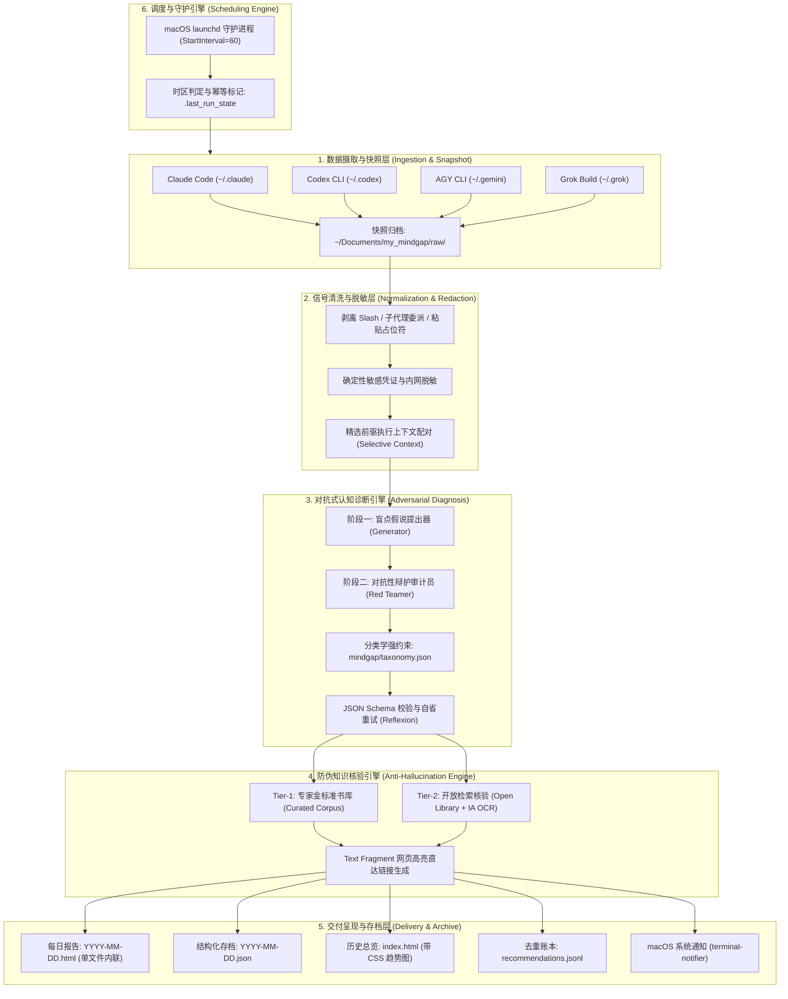
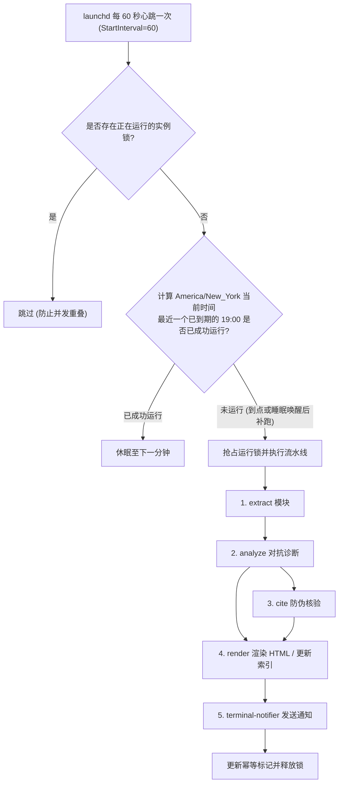

# 系统完整落地技术方案（MindGap End-to-End System Architecture）
> MindGap 深度调研体系 · 交付成果 Phase 5-B  
> 归属项目：`mindgap` | 状态：正式归档 | 版本：v1.0

---

## 概述与系统架构全景

MindGap 旨在为终端开发者构建一套**自动化、高信噪比、可机械核验、零心流打扰**的每日人机协同认知复盘系统。系统将异构的本地 CLI Agent 历史记录转化为富有顿悟价值的心智模型诊断与经典名著映射，并在本地构建安全可回溯的长期元认知档案。



---

## 一、分层架构设计与数据流转规范

### 1.1 数据摄取层（Data Ingestion Layer）
- **只读快照原则**：严禁对任何 Agent 的底层原生文件（如 `history.jsonl`、SQLite 库）执行写入或删除。系统在每日流水线启动时，首先将前一日时间窗口内的目标数据只读复制到 `~/Documents/my_mindgap/raw/history-YYYY-MM-DD.jsonl`。
- **多源插件化适配器**：
  - `ClaudeAdapter`：解析 `history.jsonl` 并通过 `sessionId` 映射 `projects/*.jsonl`；
  - `CodexAdapter`：读取 `thread_history_1.sqlite` 并提取 `userMessage` 与相关 `commandExecution`；
  - `AGYAdapter`：扫描 `brain/*/transcript.jsonl` 中 `source == 'USER_EXPLICIT'` 的记录；
  - `GrokAdapter`：解析项目目录下的 `prompt_history.jsonl` 与 `chat_history.jsonl`。

### 1.2 清洗与前驱上下文抽取层（Normalization & Context Extraction）
- **程序化噪音剔除**：过滤斜杠命令、跨 Agent 子代理委派提示词（如 `"delegation from Claude Code"`）、系统环境注入标签（`<system-reminder>` 等）。
- **确定性脱敏**：应用不可逆正则表达式替换所有 API Key、Token、密码、内网 IP 为 `[已脱敏]`。
- **精选上下文注入（Selective Context）**：
  - 为每一条人类有效 Prompt 配对紧随其后的执行回执（若命令失败，截取前 300 字符错误；若模型回复，截取前 200 字符摘要）。
  - 该机制实测以仅 **1.42x 的 Token 膨胀**，彻底消解了 36.8% 指代性提示词的语境缺失。

### 1.3 对抗式认知诊断引擎（Adversarial Diagnosis Engine）
- **Prompt 模板驱动**：所有 Prompt 模板外置化存储于 `prompts/` 目录。
- **双阶段对抗流水线**：
  1. *Generator* 结合 `mindgap/taxonomy.json` 中的 10 大盲点，提出 2~3 个候选及证据引言。
  2. *Red-Team Critic* 以辩护律师立场，使用反例标准进行严厉证伪，剔除合法工程探索与断章取义。
  3. 最终通过模型子进程（如 `claude -p --output-format json`）输出，并经由 `jsonschema` 执行强类型校验。若解析失败，触发包含错误堆栈的二次自省重试。

### 1.4 防伪知识核验引擎（Anti-Hallucination Citation Engine）
- **双层混合检索策略**：
  - 优先从本地已校准的金标准书籍库加载书摘；
  - 长尾场景下调用 Open Library API 核验作品出版年与作者，拉取公开页面正文进行滑动窗口 N-Gram 字母流比对。
- **Text Fragment 直达生成**：为每条逐字核实成功的引文构建 `#:~:text=start,end` 锚点链接。
- **诚实核验报告**：对未能在公开网页匹配的引文，严格在 JSON 和 HTML 中标注 `SOURCE_UNVERIFIED` 并标红，坚决不进行虚假粉饰。

### 1.5 呈现与存档层（Presentation & Archive Layer）
- **单文件自包含 HTML**：每日报告存储为 `~/Documents/my_mindgap/YYYY/MM/YYYY-MM-DD.html`。所有样式内嵌，支持 CSS 变量自适应操作系统深浅色模式，零外部网络依赖。
- **结构化元数据**：同步生成 `YYYY-MM-DD.json`。
- **去重账本**：每次推荐成功后，向 `~/Documents/my_mindgap/recommendations.jsonl` 追加一行（日期、书名、作者、盲点标签），保证连续推荐的书籍不重复。
- **历史总览索引**：每次运行重渲 `~/Documents/my_mindgap/index.html`，展示天数统计、纯 CSS 每日 Prompt 柱状图、历史卡片流与核验比例。
- **系统通知推送**：利用 `terminal-notifier` 弹出通知，配置 `-open "file://..."`，用户点击通知直接调起默认浏览器阅读报告。

---

## 二、macOS 调度与运行环境深度评测与选型

系统必须在无人值守的情况下，每日精准运行一次（目标时点为 America/New_York 19:00，对应的本机 Asia/Shanghai 时间为次日 07:00 或 08:00，受夏令时影响）。



### 2.1 三大调度方案的横向评测

| 维度 | **方案 A: cron 定时任务** | **方案 B: 终端 Shell Hook (preexec)** | **方案 C: macOS launchd 守护服务** |
| :--- | :--- | :--- | :--- |
| **原生系统支持** | macOS 官方已废弃，受限于 SIP 权限 | 仅在用户打开终端交互时触发 | **macOS 第一公民，官方标准守护服务** |
| **机器睡眠唤醒补跑** | 否（睡眠直接跳过，造成当天数据永久丢失） | 否（无交互则不触发） | **能（通过状态轮询检测可秒级补跑）** |
| **跨夏令时与时区处理**| 困难（crontab 固定按本机时钟运行） | 困难 | **优秀（通过脚本内显式时区运算处理）** |
| **后台无感知静默执行**| 是 | 否（打断用户正常终端会话） | **是（完全脱离前台终端独立运行）** |

### 2.2 为什么必须摒弃 `StartCalendarInterval`？
在 Spike 阶段的实测中，注册的 `StartCalendarInterval` 出现 **3 次到点未触发** 的情况。深度排查揭示了其在现代 macOS（Darwin 25.6）上的两个致命短板：
1. **时区写死陷阱**：macOS 的 `StartCalendarInterval` 只能读取系统硬件时区（本机为 `Asia/Shanghai`）。而目标复盘周期是 `America/New_York` 19:00。在夏令时切换点（11 月第一个周日），若在 plist 中写死小时数，会导致触发时间偏移整整 1 小时。
2. **睡眠唤醒边缘 Case**：若机器在触发时点处于完全休眠状态，唤醒后 `StartCalendarInterval` 的事件派发机制在某些 macOS 版本中存在静默丢失的问题。

### 2.3 生产级决策：`StartInterval=60` 状态驱动轮询与幂等标记
我们采用已被业界验证最稳健的守护模式：
- **plist 配置**：设置 `StartInterval=60`（每分钟 tick 一次）配合 `RunAtLoad=true`。
- **Python 脚本自省决策**：
  ```python
  from datetime import datetime, timezone
  from zoneinfo import ZoneInfo

  def should_run():
      ny_tz = ZoneInfo("America/New_York")
      now_ny = datetime.now(ny_tz)
      
      # 计算最近一个应当运行的目标时间（纽约时间 19:00）
      if now_ny.hour >= 19:
          target_date = now_ny.date()
      else:
          target_date = (now_ny - timedelta(days=1)).date()
          
      # 检查该日期是否已经成功写入过标记文件
      state_file = Path("~/Documents/my_mindgap/.last_run_date").expanduser()
      if state_file.exists() and state_file.read_text().strip() == str(target_date):
          return False, None
      return True, target_date
  ```
- **核心收益**：
  1. 自动免疫时区与夏令时切换；
  2. 机器一旦从睡眠中唤醒，在 **60 秒内立即检测到漏跑并无缝补跑**；
  3. 通过写入 `.last_run_date` 实现严格的物理幂等性，杜绝重复计算。

### 2.4 launchd 运行环境隔离与配置规范
由于 launchd 启动的子进程默认工作目录为 `/`，且其 `PATH` 仅包含 `/usr/bin:/bin:/usr/sbin:/sbin`，必须在 plist 中显式声明环境变量：

```xml
<?xml version="1.0" encoding="UTF-8"?>
<!DOCTYPE plist PUBLIC "-//Apple//DTD PLIST 1.0//EN" "http://www.apple.com/DTDs/PropertyList-1.0.dtd">
<plist version="1.0">
<dict>
    <key>Label</key>
    <string>com.mindgap.daily</string>
    <key>WorkingDirectory</key>
    <string>/Users/ai/github/my_projects/mindgap</string>
    <key>EnvironmentVariables</key>
    <dict>
        <key>PATH</key>
        <string>/Users/ai/.local/share/mise/shims:/opt/homebrew/bin:/usr/local/bin:/usr/bin:/bin:/usr/sbin:/sbin</string>
        <key>HOME</key>
        <string>/Users/ai</string>
    </dict>
    <key>ProgramArguments</key>
    <array>
        <string>/Users/ai/.local/share/mise/shims/python3</string>
        <string>-m</string>
        <string>mindgap.runner</string>
    </array>
    <key>StartInterval</key>
    <integer>60</integer>
    <key>RunAtLoad</key>
    <true/>
    <key>StandardOutPath</key>
    <string>/Users/ai/Documents/my_mindgap/launchd-stdout.log</string>
    <key>StandardErrorPath</key>
    <string>/Users/ai/Documents/my_mindgap/launchd-stderr.log</string>
</dict>
</plist>
```

---

## 三、系统容灾、预算治理与隐私边界

1. **预算硬上限（Budget Cap）**：
   - 调用外部大模型分析时，硬编码注入 `--max-budget-usd 1.50` 参数；
   - 单日总开销超出设定阈值时，自动熔断并降级为仅输出基础会话统计与极简报告。
2. **超时自愈（Process Watchdog）**：
   - 联网核验与分析调用设置 300 秒硬超时，防止网络死锁挂起守护进程。
   - `terminal-notifier` 调用通过后台异步派发（`nohup` 或 Python `subprocess.Popen` 无阻塞返回），杜绝因用户未点击通知而阻塞主流水线。
3. **全本地运行与零外泄（Zero-Exfiltration Guarantee）**：
   - 所有的清洗、脱敏、HTML 生成均在本地进程完成；
   - 所有的结构化存档永久保留在本地 `~/Documents/my_mindgap`，绝不向任何第三方云平台同步未脱敏的代码与会话详情。

---

## 四、演进路线与模块划分指南

```
mindgap/
├── mindgap/
│   ├── __init__.py
│   ├── extract.py          # 多源 Agent 日志摄取与脱敏
│   ├── analyze.py          # 两阶段 Generator-Critic 诊断引擎
│   ├── verify.py           # 机器引文防伪核验引擎
│   ├── render.py           # HTML / JSON / 索引渲染引擎
│   ├── notify.py           # terminal-notifier 异步通知封装
│   ├── runner.py           # launchd 驱动的幂等状态机主入口
│   └── taxonomy.json       # 机械可读的标准认知盲点库
├── prompts/
│   ├── generator.txt       # 假说提出 Prompt
│   ├── critic.txt          # 对抗性红队审计 Prompt
│   └── cite_search.txt     # 动态出处检索 Prompt
├── tests/
│   ├── test_extract.py     # 窗口切割与脱敏单测
│   ├── test_taxonomy.py    # Schema 验证与正交性测试
│   └── test_verify.py      # 滑动窗口比对与连字符容错单测
└── launchd/
    └── com.mindgap.daily.plist # 标准守护配置文件
```
