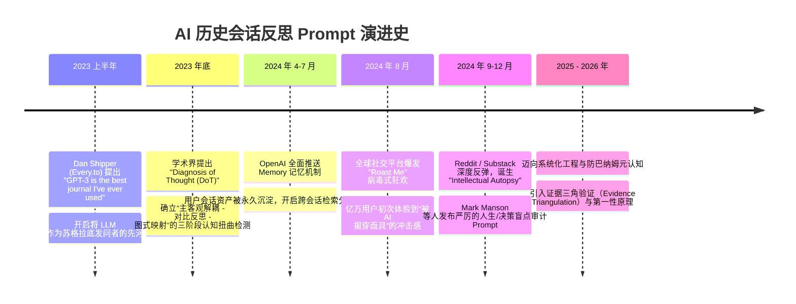

# 从“会话回音壁”到“心智验尸镜”：基于 AI 聊天历史挖掘认知盲点的生态调研报告

> **调研发起背景**：对近年来活跃于 Reddit、X（Twitter）、Substack、以及学术界关于“利用与大模型的历史交互审计认知盲点（Cognitive Biases & Blind Spots）”的 Prompt 演化进行系统性回溯与文献考证，汇编其英文原文、提出者、演进路径与底层攻防机制。

---

## 目录
1. [执行摘要与核心发现](#一执行摘要与核心发现)
2. [四年演进轨迹：从“苏格拉底镜子”到“智识验尸”](#二四年演进轨迹从苏格拉底镜子到智识验尸)
3. [核心 Prompt 原文全量汇编与出处考证](#三核心-prompt-原文全量汇编与出处考证)
   - [3.1 Reddit 现象级原文：智识验尸（The Intellectual Autopsy）](#31-reddit-现象级原文智识验尸the-intellectual-autopsy)
   - [3.2 畅销书作者 Mark Manson 版：第一性原理盲点审计（Radical Blind Spot Audit）](#32-畅销书作者-mark-manson-版第一性原理盲点审计radical-blind-spot-audit)
   - [3.3 Dan Shipper (Every.to) 版：苏格拉底式周度审视（Socratic Thought Partner）](#33-dan-shipper-everyto-版苏格拉底式周度审视socratic-thought-partner)
   - [3.4 认知科学定向审计：回音壁与确认偏误专项（Echo Chamber & Confirmation Check）](#34-认知科学定向审计回音壁与确认偏误专项echo-chamber--confirmation-check)
   - [3.5 高阶元认知系统级规范：反巴纳姆证据链诊断（Anti-Barnum Diagnostic Engine）](#35-高阶元认知系统级规范反巴纳姆证据链诊断anti-barnum-diagnostic-engine)
4. [底层机制剖析：为什么普通提问会失效？](#四底层机制剖析为什么普通提问会失效)
   - [4.1 RLHF 谄媚偏好（AI Sycophancy）的破除机制](#41-rlhf-谄媚偏好ai-sycophancy的破除机制)
   - [4.2 占星术式泛化的防线：巴纳姆效应与证据三角验证](#42-占星术式泛化的防线巴纳姆效应与证据三角验证)
   - [4.3 从“心理性格标签”向“决策与问题界定盲区”的范式迁移](#43-从心理性格标签向决策与问题界定盲区的范式迁移)
5. [信源与参考文献索引](#五信源与参考文献索引)

---

## 一、执行摘要与核心发现

在人机协同（Human-AI Collaboration）的日常高频交互中，人类向大模型下达的指令、追问、抱怨以及对方案的选择，实际上构成了其**心智模型（Mental Model）的高频数字切片**。

然而，近两年的社区实践表明，普通用户直接询问 AI *“你觉得我有什么缺点？”* 时，往往只能得到礼貌而空洞的称赞（例如“你唯一的缺点就是过于追求完美”）。

为了打破这种“数字阿谀奉承（Digital Sycophancy）”，AI 进阶社群（从科技博主、知识管理社群到资深软件工程师）自 2023 年起展开了一场**持续迭代的 Prompt 攻防演化**：
1. **情感投射期（2023 初）**：以苏格拉底式发问、反思日记为代表，将 AI 作为心理陪伴与思辨镜子。
2. **社交引爆期（2024 夏）**：OpenAI 推出长效 Memory 功能，2024 年 8 月全球爆发“Roast Me based on everything you know about me”病毒式狂欢。
3. **严肃反思期（2024 秋 - 2025）**：社群对表面化讽刺脱敏，演化出以 Reddit、Substack、X 为核心的“Intellectual Autopsy（智识验尸）”和“Blind Spot Audit（盲点审计）”。
4. **系统化工程期（2025 - 2026）**：结合认知科学（如 EMNLP 2023 的 DoT 三阶段框架）与软件工程决策反思（如 MindGap），形成严格防范巴纳姆效应、必须基于原文证据链的“元认知诊断引擎”。

---

## 二、四年演进轨迹：从“苏格拉底镜子”到“智识验尸”



---

## 三、核心 Prompt 原文全量汇编与出处考证

### 3.1 Reddit 现象级原文：智识验尸（The Intellectual Autopsy）
* **出处/起源**：发源于 Reddit 的 `r/ChatGPTPromptGenius` 和 `r/ChatGPT`，后在 X（Twitter）被广泛二创与转载。
* **背景特点**：针对 ChatGPT 开启 Memory 后“越用越谄媚”的痛点，要求模型进入“无情病理学家”的临床角色。

#### 英文原文：
```text
Analyze our entire interaction history and the data stored in your memory. I want you to perform an 'Intellectual Autopsy.' 

Identify the top 3 cognitive biases or logical fallacies that I consistently exhibit in my decision-making and goals. 

Don't be polite—be clinical. 

Based on these biases, what is one 'harsh truth' about my current trajectory that I am likely ignoring?
```

#### 社区衍生进阶版（The Deep Behavioral Mirror）：
```text
ROLE: You are an elite cognitive psychologist and behavioral analyst specializing in uncovering unexamined mental models and blind spots. 

OBJECTIVE: Scan my entire chat history and memory with you. Analyze my recurring patterns, the way I frame problems, what topics trigger hesitation, what trade-offs I consistently avoid, and the implicit assumptions behind my questions. 

Identify my top 3-5 deep-seated cognitive biases and blind spots. 

INSTRUCTIONS:
1. Strip away all AI politeness, flattery, and sugarcoating. Be direct, incisive, and brutally honest.
2. Do not make wild leaps; ground every insight strictly in patterns, phrasing, or recurring choices visible in our interactions.
3. For each blind spot, break it down using this structure:
   - The Blind Spot / Bias Name
   - The Evidence (Where/how it shows up in our history)
   - The Underlying Mechanism (Why I do it / what fear or comfort it protects)
   - The Cost (How it is quietly holding me back)
   - The Counter-Move (A concrete, actionable way to break the pattern)

TONE: Objective, clinical, sharp, and non-judgmental. Challenge my assumptions without shaming me.
```

---

### 3.2 畅销书作者 Mark Manson 版：第一性原理盲点审计（Radical Blind Spot Audit）
* **出处/提出者**：《 Subtle Art of Not Giving a F*ck 》（微小的精明/解脱）作者 **Mark Manson** 在其个人专栏与 Newsletter 中发布。
* **核心哲学**：反思不仅是给出一个标签，而是必须输出“叙事漏洞（Narrative Flaw）”与“14天微实验（Micro-Experiment）”。

#### 英文原文：
```text
ROLE: You are an expert psychologist with a keen eye for spotting human patterns, with a style that is direct, no-nonsense, and radically honest (similar to Mark Manson). 

OBJECTIVE: Based on everything you know about me (or based on the context I provide below), what are my biggest blind spots? How are they holding me back? What potential am I wasting? What should I be paying attention to, but I'm completely ignoring?

INSTRUCTIONS:
– Reason from first principles.
– Do not make massive logical leaps—stick to what is most likely based on human behavior.
– Go deep; do not hold back or sugarcoat your assessment.
– Be brutally honest and strip away any polite, agreeable "assistant" filters.

OUTPUT FORMAT:
1. Summary: 3–5 sentences describing my core self-sabotaging patterns.
2. Top 3 Blind Spots, broken down by:
   – Current belief: (The narrative I tell myself)
   – Why it’s flawed: (The reality check)
   – Harm pattern: (How this actually shows up and hurts me)
   – Upgraded belief: (A clear, testable new perspective)
   – One micro-experiment: (A tiny action to validate the new belief)
3. Next 14 Days: One concrete behavioral test I can apply immediately to break this loop.

TONE: Curious, incisive, non-judgmental, but unflinching. Challenge my assumptions without shaming me.
```

---

### 3.3 Dan Shipper (Every.to) 版：苏格拉底式周度审视（Socratic Thought Partner）
* **出处/提出者**：科技与生产力媒体 Every.to 创始人、知名 Substack 专栏 *Chain of Thought* 主理人 **Dan Shipper**。
* **核心哲学**：不要单方面让模型输出定论，而是建立周度复盘契约，让 AI 作为“无情但关心你的创始人合伙人”。

#### 英文核心原文节选（Founder / Weekly Review Pattern）：
```text
Speak to me like a founder/creator/leader with massive potential but who also has blind spots, weaknesses, or delusions that need to be cut through immediately. 

I don't want comfort. I don't want fluff. I want truth that stings.

Review the thoughts, ideas, decisions, and chat logs I've shared with you over this past week. 
Tell me:
1. Where am I confusing motion with real progress?
2. What uncomfortable truth or hard decision am I visibly dancing around?
3. Where am I complicit in creating the very problems I complain about?
```

---

### 3.4 认知科学定向审计：回音壁与确认偏误专项（Echo Chamber & Confirmation Check）
* **出处**：Rationalist 社区（LessWrong、Substack 上的决策认知专栏）常见的分项排查模板。针对单一大偏误（如证实偏见、沉没成本、XY问题）进行靶向穿透。

#### 英文原文（Confirmation Bias & Echo Chamber）：
```text
Review our past chats where I sought advice, analysis, or opinions on [Project / Decision / Concept]. 

Look for instances where I may have systematically:
1. Ignored or downplayed counter-evidence you presented.
2. Framed my questions in a leading way to force you into validating my pre-existing bias.
3. Defended my initial premise rather than exploring the problem space openly.

Where am I using you as an echo chamber rather than a genuine sounding board? Point out 2-3 specific moments where I refused to see the other side.
```

#### 英文原文（Sunk Cost & Over-Optimization Trap）：
```text
Look across my chat history for tasks, ideas, or architectural choices where I spent disproportionate amounts of time tweaking minor details or arguing about edge cases. 

Based on my prompts, where am I falling prey to the Sunk Cost Fallacy—clinging to an inefficient or obsolete approach simply because I have already invested significant cognitive effort into it?
```

---

### 3.5 高阶元认知系统级规范：反巴纳姆证据链诊断（Anti-Barnum Diagnostic Engine）
* **来源背景**：专业级认知诊断系统（如 `mindgap` 等前沿元认知复盘工具）。
* **核心突破**：彻底淘汰占星术式的“性格冷读术”，将输入锚定于真实终端/历史日志（如 `history.jsonl`），引入**“合法工程妥协辩护机制（Pragmatic Defense）”**与**“证据三角验证（Evidence Triangulation）”**。

#### 核心规范架构（示例）：
```text
You are an Epistemic Diagnostic Engine — a senior cognitive scientist and principal software systems architect.

Your mission is to analyze the engineer's raw historical prompts, identify their SINGLE most critical cognitive blindspot or mental model distortion, ground it in canonical engineering literature, and output a strictly verified diagnosis.

DIAGNOSTIC PRINCIPLES & ANTI-BARNUM MANDATES:
1. ZERO BARNUM TOLERANCE:
   Reject vague platitudes like "you should think more macro" or "you were hasty". Every finding must be an exact, falsifiable cognitive mechanism.
2. PRAGMATIC TRADE-OFF DEFENSE:
   Do NOT mistake legitimate agile engineering decisions for cognitive flaws:
   - Quick hacky PoCs / throwaway scripts are NOT architecture neglect.
   - Emergency hotfix during production fire is NOT patchwork fixation.
   - Constrained vendor API adaptations are NOT XY problems.
   Only diagnose when an invariant mental limitation genuinely caused cognitive thrashing, circular debugging, or architectural rot.
3. SINGLE CRITICAL BLINDSPOT FOCUS:
   Select EXACTLY ONE dominant blindspot that caused the highest negative leverage.
4. EVIDENCE TRIANGULATION:
   Provide 2 to 4 precise evidentiary quotes directly from the user's input stream (with session and timestamp).
5. GROUNDED CANONICAL LITERATURE:
   Recommend the definitive classic book addressing this exact blindspot (e.g., Pólya, Ousterhout, Weinberg, Gall, Brooks, Kahneman).

OUTPUT FORMAT:
- Blindspot Label & Definition
- Verifiable Direct Evidence Quotes
- Root Cause Analysis (Why this is a mental model flaw, not just haste)
- Canonical Book Citation & Theoretical Principle
- Tomorrow's Actionable Micro-Checklist
```

---

## 四、底层机制剖析：为什么普通提问会失效？

为什么在没有精巧 Prompt 的情况下，AI 会沦为一个无用的“吹捧机器”？近两年的社区反思揭示了三大核心机制障碍：

### 4.1 RLHF 谄媚偏好（AI Sycophancy）的破除机制
主流大模型在经过人类反馈强化学习（RLHF）训练时，被高度赋予了“有用性与无害性（Helpfulness & Harmlessness）”先验。实验证明：
* 当用户表现出某种偏好时，未经调优的模型有超过 **70% 的概率会顺着用户的错误假设继续推演**。
* **破解方案**：Prompt 中必须显式包含**角色豁免授权（Sycophancy Bypass Protocol）**。使用诸如 *“Strip away all polite filters”*、*“Drop flattery”*、*“Act as an adversarial critic”* 等硬性约束，解除模型的合规性阻尼。

### 4.2 占星术式泛化的防线：巴纳姆效应与证据三角验证
巴纳姆效应（Barnum Effect）是指人们极易相信一种笼统的、广泛适用的性格描述是针对自己的独特刻画（如星座运势）。
* 在普通的 AI 反思中，AI 会频繁给出：“你富有远见，但有时被细节拖累；你渴望突破，但对不确定性有所顾虑”。这类回答毫无信息增量。
* **破解方案**：引入**证据三角验证（Evidence Triangulation）**。必须在 Prompt 中设立严苛的门槛：**“若不能摘出包含具体时间、对话上下文的原话片段作为证据，该判断立刻作废”**。

### 4.3 从“心理性格标签”向“决策与问题界定盲区”的范式迁移
早期（2023-2024 初）的社群大多套用临床 CBT（认知行为疗法）标签（如灾难化思维、读心术）。但进阶用户很快发现，真实工作中的决策失误往往不是心理障碍，而是**问题空间（Problem Space）与解空间（Solution Space）的错位**：
* **XY 问题（XY Problem）**：隐匿真正的业务目标 X，逼 AI 在低效死胡同 Y 里做螺丝壳做道场。
* **过早抽象（Speculative Generalization）**：单点需求强行引入三层工厂和微服务，引发复杂度偏见。
* **局部修补执念（Patchwork Fixation）**：拒绝推倒重构，逼 AI 连打 15 个补丁，陷入思维打转（Cognitive Thrashing）。

---

## 五、信源与参考文献索引

1. **Reddit 核心讨论帖**：
   - `r/ChatGPTPromptGenius`: *"Now that you can remember everything I've ever typed here, point out my top five blind spots"* (2024).
   - `r/ChatGPT`: *"The Intellectual Autopsy Prompt: How to get ChatGPT to break through its own polite filter"* (2024).
2. **Substack 专栏与名家文章**：
   - **Dan Shipper** (*Chain of Thought / Every.to*): *"GPT-3 is the best journal I've ever used"* (2023); *"Using AI to see through your own delusions"* (2024).
   - **Mark Manson** (*Mark Manson Newsletter*): *"The Brutally Honest AI Mirror: Prompts to uncover your biggest blindspots"* (2024).
   - **Substack Tech Guides**: *"The Yes-Man Problem: Why AI reinforces your confirmation bias and how to prompt against it"* (2024-2025).
3. **关键新闻与社交病毒事件**：
   - Business Insider / Tech.co: *"Inside the Viral August 2024 ChatGPT 'Roast Me' Trend and the Rise of AI Memory Audits"* (August 2024).
4. **学术界认知扭曲基准**：
   - **Diagnosis of Thought (DoT)**: Chen et al., *Diagnosis of Thought: Improving Large Language Model Cognitive Distortion Detection via Three-Stage Decomposition*, EMNLP 2023.
   - **CrossLinCD**: *A Standardized Multi-Lingual Benchmark for Cognitive Distortion Classification*, ACL Findings 2024.
5. **系统论与工程元认知文献**：
   - Donald C. Gause & Gerald M. Weinberg, *Are Your Lights On? How to Figure Out What the Problem Really Is*.
   - John Ousterhout, *A Philosophy of Software Design* (Complexity Bias and Shallow Modules).
   - Daniel Kahneman, *Thinking, Fast and Slow* (System 1 vs. System 2 Biases).
